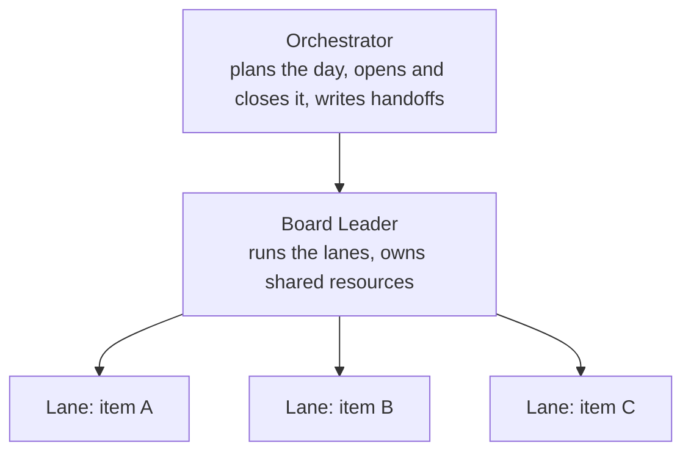

# sessions-managing-sessions

How one developer runs a working day with several Claude Code sessions in parallel: one session plans, one runs the work lanes, each work item gets its own session, everything reports back, and only the human approves.

This is a working pattern, not a product. It was built step by step over about a month on one machine (Windows 11, 32 GB RAM, Claude desktop app) and is shared so other teams can copy the parts that fit.

## The idea in one picture

Three rules hold it together:
1. Only the human's own words are a go. A lane's "done", a reviewer's "looks fine" and an OK from the layer above are information, never approval.
2. One lane = one parent work item.
3. Shared resources (browser, database server, ports, RAM) have one owner.

## Start here
- [Copy it yourself in 3 steps](docs/pattern/copy-it.md)
- [Topology: three layers, or two](docs/pattern/topology.md)
- [The three rules](docs/pattern/rules.md)
- [Stop tags and session titles](docs/pattern/tags-and-titles.md)
- [Status files: the shared sync file and the day file](docs/pattern/status-files.md)
- [What it costs: LLM vs script](docs/pattern/cost.md)
- [Before and after (observations)](docs/pattern/results.md)
- [What one lane runs: the 13 phases and what each is built on](docs/dev-flow-overview.md)
- [What RAM it takes](docs/ram.md)
- [The board: a status view on top of the files](docs/pattern/board.md)

## Role instructions
The instruction files each coordinating session and lane follows. Point a session at its file when it starts.
- [Contract: the layers, rules, titles and duties](roles/contract.md)
- [Orchestrator](roles/orchestrator.md) · [Board Leader](roles/board-leader.md) · [Lane](roles/lane.md)

## Skills
Copy a skill folder into `~/.claude/skills/` (user level) or `<repo>/.claude/skills/` (project level).

| Skill | What it does |
|---|---|
| [`dev-flow`](skills/dev-flow/SKILL.md) | A 13-phase flow for one work item in one lane: spec read, plan agreement, strict TDD, reviews, UI verification, commit and hand-off, with human approval gates. |
| [`handoff`](skills/handoff/SKILL.md) | Writes a handoff document so a fresh session can continue the work. |
| [`lgtm`](skills/lgtm/SKILL.md) | A lane records its state in the day file and reports it to its parent. It approves nothing. |
| [`office-start`](skills/office-start/SKILL.md) | The Orchestrator's morning: what changed since the last working log, today's meetings (optional), and today's plan. |
| [`office-end`](skills/office-end/SKILL.md) | The Orchestrator's day close: reads every lane's block and appends one Day close to the day file. |
| [`handover`](skills/handover/SKILL.md) | Hands a coordinating role (Orchestrator or Board Leader) to a fresh session under the same role title. |

A day: `/office-start` → `/handoff` (one per item; the Board Leader starts the lane) → lanes report with `/lgtm` → `/office-end`, with `/handover` when a coordinating session's transcript gets long. `/board` is the status view's own command, not a skill ([board.md](docs/pattern/board.md)).

The skills assume a git-ignored scratch folder (`<scratch>/`) and a shared status file (`<shared>/orchestrator-sync.md`). Pick your own paths.

## How it got here
- [The journey: from a role team per item to three layers](docs/journey.md), with the ideas that were dropped and why.

## Evaluations
- [Would .NET Aspire help this setup?](docs/aspire-evaluation.md)
- [Solo lanes vs team lanes](docs/solo-vs-team-lanes.md)

## Not included
- The code of the board UI (a band above the prompt and a lane detail pane). It is a personal mod; [board.md](docs/pattern/board.md) describes what it shows and reads, and the pattern works without it.
## Credits
- `skills/handoff` is derived from the `handoff` skill in [mattpocock/skills](https://github.com/mattpocock/skills) (MIT). `dev-flow` recommends the `grill-me` skill from the same repository. See [NOTICE](NOTICE).
- `dev-flow` phases build on skills from [obra/superpowers](https://github.com/obra/superpowers) and [everything-claude-code](https://github.com/affaan-m/everything-claude-code). They are not included; see [the overview](docs/dev-flow-overview.md).

## License
Not chosen yet: see [LICENSE](LICENSE).
