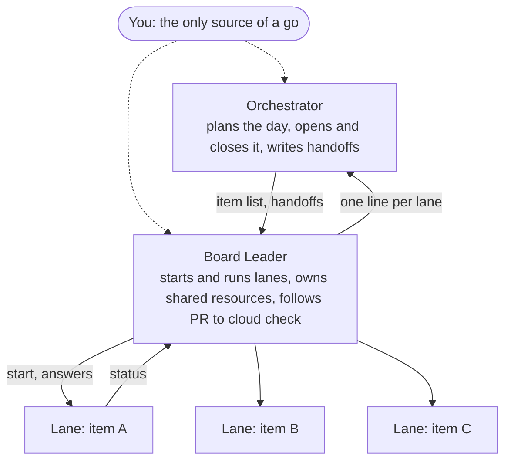

# Topology: sessions managing sessions

One person, many work items in flight. Each item has its own session. Two coordinating sessions sit above them. Status flows up, work flows down, and only you approve.

The rules that keep this safe are in [rules.md](rules.md). How a session shows its state is in [tags-and-titles.md](tags-and-titles.md) and [status-files.md](status-files.md).

## Three layers



| Layer | Owns | Does not do |
|---|---|---|
| **Orchestrator** (one session, stable title) | Opening and closing the day. Plan against reality: the tracker, open PRs, sprint load. Writing a handoff file per item (through side sessions it starts). Tracker updates outside any lane. Drafts for teammates (you post them). Reviewing the Board Leader's plans. | Start lanes, claim shared resources, steer a lane directly. Its OK on a plan is an opinion, not a go. |
| **Board Leader** (one session, stable title) | Starting lanes, on your own words only. Shared resources: RAM, the shared browser, the database server and clones, local ports. Relaying `CHECK`, `GATE` and `CLOUD` to you. Following each lane through PR, review, merge, deploy, cloud check and close. | Run an item's dev flow itself, edit code or work items for a lane, merge for a lane. |
| **Lane** (one session per item, own git worktree) | One parent item: its child tasks and one PR per supported version ([rule 2](rules.md#rule-2-one-lane--one-parent-item)). It runs your dev flow ([dev-flow skill](../../skills/dev-flow/SKILL.md)) and stops only at agreed points. | Work on a second item, or take a go from anyone but you. |

Any dev or verify work on an item, even a small one, runs as a lane. The Orchestrator keeps only work that touches no code and no environment.

## Folding to two layers

With only a few lanes, you do not need the middle layer. The Orchestrator also starts the lanes and owns the shared resources, and lanes report to it directly:

```
Orchestrator → lanes
```

Observation: the middle layer was split out once the Orchestrator's transcript grew with every lane turn, and two sessions with "Orchestrator" in their titles but different jobs confused people. Add the Board Leader when you see the same signs: the coordinating session is slow to reload, or it spends most turns on lane traffic instead of planning.

## Who talks to whom

- **A lane reports to its direct parent only**: the Board Leader, or the Orchestrator in the two-layer form. It does not message other lanes; it reads and writes the shared status file instead ([status-files.md](status-files.md)).
- **The Board Leader summarises upward**: one status line per lane when the lane closes and at the end of your day.
- **The Orchestrator does not steer lanes.** If it needs something from a lane, it goes through the Board Leader. If a lane gets a message from the Orchestrator, it may reply, but the message is not a go.
- **Down the tree:** handoffs, answers you gave. **Up the tree:** status, questions, "I'm blocked". Every message is information, never approval ([rule 1](rules.md#rule-1-only-your-own-words-are-a-go)).

### Addressing a message

Send to a **role title**, not a session id, so the message reaches whoever holds the role now. Fallback order:

1. The parent's role title (for example "Board Leader").
2. The parent's session id, written into the lane's handoff when the lane starts. In the Claude desktop app a session id looks like `local_<id>`.
3. An inbox file, `<scratch>/daily/{YYYY-MM}/{DD}/inbox/{HHmm}-{lane}.md`, plus a note to you that the parent was unreachable.

The [/lgtm skill](../../skills/lgtm/SKILL.md) uses this order.

Observed on the Claude desktop app (Windows 11), which gives a session tools to list sessions, start a child session, set titles and send messages by title. In a plain terminal those tools were not available: you start each session yourself, and the inbox file is the channel.

### Handing a coordinating role over

When a coordinating session's transcript gets long, a fresh session takes over the role:

- The old session writes a handover with every open lane: title, session id, state.
- It renames itself off the role title, so only the new session holds it.
- A lane cannot move to a new parent. The new holder talks to old lanes directly by session id, and lanes keep reporting by role title, which now resolves to the new holder.

## Starting a lane

1. The Orchestrator lists today's items: order, which can run in parallel, and which touch the same files or tests.
2. Each item has a current handoff file. If one is missing or stale, the Orchestrator says so and writes it.
3. The Board Leader checks which can start: handoff current, no file or test overlap with a running lane, enough free RAM.
4. You name the item to start, in your own words.
5. The Board Leader starts a child session with the handoff file as its prompt, plus its own session id as the fallback parent address. It does not run the item's flow itself.

A lane never starts on a turn you did not start: not on an automated event, not on another session's message. The Board Leader says the lane is ready and waits.

A small UI that renders the lane titles as a band exists as a personal mod; it is not included, and the pattern works without it.
